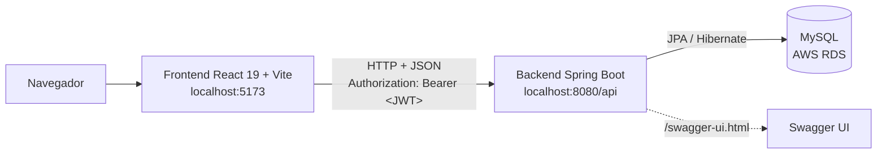
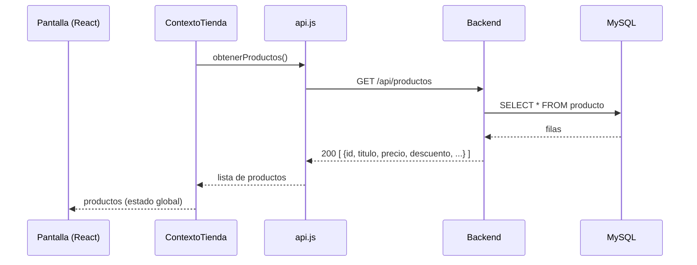
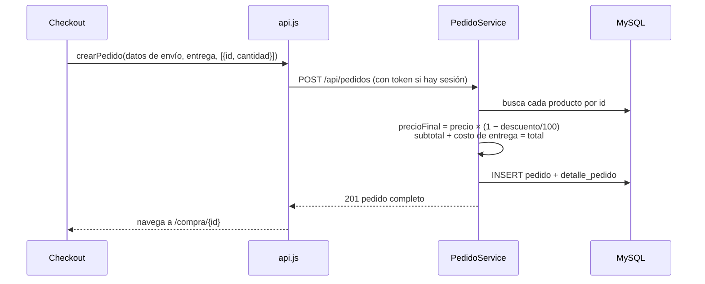
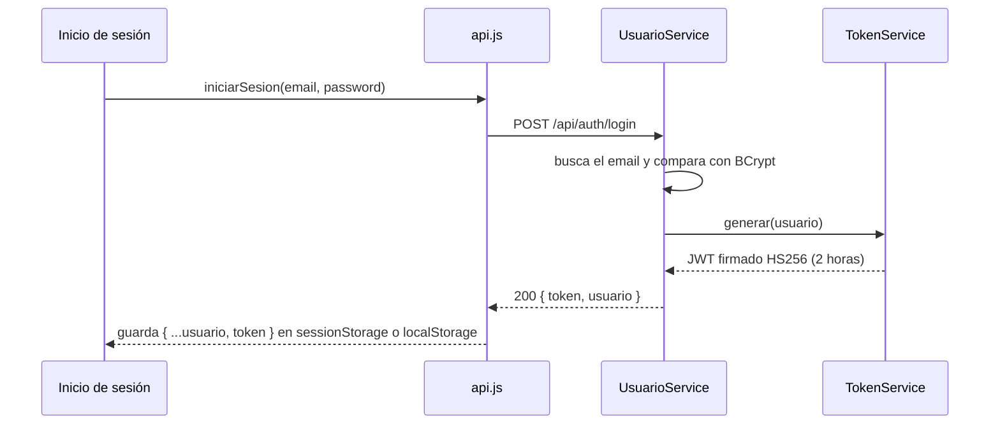

# Documento de integración: frontend React y backend Spring Boot

Pastelería 1000 Sabores. Evaluación Parcial 3, DSY1104 Desarrollo Fullstack II.

Este documento explica cómo se comunican el frontend (FrontPasteleria) y el backend (BackPasteleria) mediante la API REST, cómo se protege esa comunicación con JWT y roles, y cómo el frontend mantiene la sesión y restringe pantallas según el rol.

## 1. Arquitectura



| Capa | Tecnología | Responsabilidad |
| --- | --- | --- |
| Frontend | React 19, React Router 7, Vite, Bootstrap | Pantallas, carrito, validaciones de formulario, sesión y restricciones por rol |
| Comunicación | fetch + JSON, CORS | Un solo cliente HTTP (`src/services/api.js`) para todas las peticiones |
| Backend | Spring Boot 4, Spring Security (OAuth2 Resource Server), Spring Data JPA, springdoc-openapi | Lógica de negocio, validación, autenticación JWT, autorización por rol, documentación Swagger |
| Datos | MySQL en AWS RDS | Tablas `usuario`, `producto`, `consulta`, `pedido` y `detalle_pedido` |

El backend sigue la estructura por capas **controller → service → repository → entity**. Los controladores solo reciben y responden, los servicios contienen la lógica de negocio y los repositorios (Spring Data JPA) acceden a la base de datos.

## 2. Modelo de datos

| Entidad | Campos principales | Reglas del cliente que refleja |
| --- | --- | --- |
| Usuario | id, nombre, apellido, email (único), password (BCrypt), rol, direccion, tipoPropiedad, region, comuna | El registro público siempre crea un `cliente`; la contraseña nunca se devuelve en JSON (`WRITE_ONLY`) |
| Producto | id, titulo, descripcion, imagen, categoria, precio, descuento (0 a 100) | Catálogo por categorías con descuento porcentual |
| Consulta | id, nombre, correo, mensaje, fecha, estado | Formulario de contacto; estados `pendiente`, `en revisión`, `resuelta` |
| Pedido | id, fecha, estado, correoCliente, datos de envío, entrega, costoEntrega, subtotal, total | Compra con despacho a domicilio ($3.000) o retiro en tienda ($0) |
| DetallePedido | productoId, titulo, imagen, categoria, precio, descuento, precioFinal, cantidad | Copia del producto al momento de la compra, para que el historial no cambie si después se edita el catálogo |

## 3. Endpoints y quién puede usarlos

Todas las rutas empiezan con `http://localhost:8080/api`. La documentación interactiva está en **`/swagger-ui.html`** (OpenAPI en `/v3/api-docs`). Las rutas protegidas muestran un candado: con el botón **Authorize** se pega el token y se prueban desde Swagger.

| Método y ruta | Acceso | Uso en el frontend |
| --- | --- | --- |
| `POST /auth/registro` | Público | Página Registro |
| `POST /auth/login` | Público | Página Inicio de sesión |
| `POST /auth/renovar` | Con token vigente | `api.js`, automático |
| `GET /productos`, `GET /productos/{id}` | Público | Catálogo, detalle, carrito |
| `POST /productos`, `PUT /productos/{id}`, `DELETE /productos/{id}` | Admin | Panel de administración: productos |
| `POST /consultas` | Público | Página Contacto |
| `GET /consultas`, `GET /consultas/{id}`, `PATCH /consultas/{id}/estado`, `DELETE /consultas/{id}` | Admin | Panel de administración: consultas |
| `POST /pedidos` | Público (con o sin sesión) | Checkout |
| `GET /pedidos/mios` | Cliente con sesión | Perfil: historial de compras |
| `GET /pedidos/{id}` | Admin o dueño del pedido | Disponible en la API |
| `GET /pedidos`, `PATCH /pedidos/{id}/estado`, `DELETE /pedidos/{id}` | Admin | Panel de administración: ventas |
| `GET /pedidos/resumen` | Admin | Disponible en la API (ingresos, ticket promedio, ranking) |
| `GET /usuarios`, `GET /usuarios/{id}`, `PUT /usuarios/{id}`, `DELETE /usuarios/{id}` | Admin | Panel de administración: usuarios |

Códigos de respuesta usados: 200, 201 (creado), 204 (eliminado), 400 (datos inválidos), 401 (sin token o token inválido), 403 (rol sin permiso), 404 (no existe), 409 (correo duplicado). Los errores siempre llegan como `{"mensaje": "..."}` gracias a `ManejadorErrores`, y el frontend muestra ese mensaje tal cual.

## 4. Cliente HTTP único del frontend

Todas las pantallas llaman a servicios (`productos.js`, `pedidos.js`, `consultas.js`, `autenticacion.js`) y estos usan una sola función, `pedirApi` en `src/services/api.js`. Ahí se resuelven una sola vez los aspectos comunes:

1. **URL base** configurable con la variable `VITE_URL_API` (por defecto `http://localhost:8080/api`).
2. **Token**: si hay sesión, agrega `Authorization: Bearer <token>`, y antes lo renueva si está por vencer (sección 6).
3. **JSON**: envía `Content-Type: application/json` y convierte la respuesta; un 204 se devuelve como `null`.
4. **Errores**: si la respuesta no es 2xx, lanza un `Error` con el mensaje del backend y el código HTTP en `error.estado`. Sin conexión, el mensaje es "No se pudo conectar con el servidor.".
5. **Token rechazado**: Spring responde 401 a un token inválido incluso en rutas públicas. En ese caso `pedirApi` borra la sesión guardada, avisa a la aplicación (evento `sesion-expirada`) y repite la petición sin token, así el catálogo y el checkout siguen funcionando.

Los adaptadores convierten los datos cuando el formato del backend no coincide con el de las pantallas. Por ejemplo, `adaptarPedido` en `pedidos.js` arma `cliente` y `entrega` a partir de los campos planos del pedido.

### CORS

El navegador bloquea peticiones entre orígenes distintos (5173 → 8080). `CorsConfig` permite los orígenes `http://localhost:5173` y `http://127.0.0.1:5173`, los métodos GET, POST, PUT, PATCH, DELETE y OPTIONS, y todas las cabeceras (incluida `Authorization`). `SecurityConfig` activa esa configuración con `.cors(...)`.

## 5. Flujos de datos principales

### 5.1 Catálogo



Los productos se cargan **una sola vez** al abrir la tienda y se guardan en el contexto (`ContextoTienda`). Inicio, catálogo, búsqueda, detalle y carrito leen de ese estado sin volver a llamar a la API. Cuando el administrador crea, edita o elimina un producto, se refresca la lista.

### 5.2 Compra



El frontend envía **solo los IDs y las cantidades**, no los precios. El backend recalcula precios, descuentos, costo de entrega y total desde la base de datos, así un usuario no puede alterar el monto desde el navegador. Si hay sesión, el pedido queda asociado al correo del token; si no, al correo del formulario.

### 5.3 Inicio de sesión



## 6. Autenticación con JWT y roles (backend)

**Contraseñas**: se guardan con BCrypt (`PasswordEncoder`), nunca en texto plano, y no se devuelven en ninguna respuesta.

**Generación** (`TokenService`): el token se firma con HMAC-SHA256 usando el secreto `app.jwt.secret` (en producción, variable de entorno `JWT_SECRET`). Contiene:

| Dato | Contenido |
| --- | --- |
| `sub` | Correo del usuario |
| `rol` | `admin` o `cliente` |
| `iat` / `exp` | Emisión y vencimiento (2 horas, `app.jwt.horas`) |
| `inicio` | Momento del login con contraseña |
| `iss` | `pasteleria-1000-sabores` |

**Verificación**: Spring Security actúa como *resource server*. En cada petición valida la firma y el vencimiento del token con `NimbusJwtDecoder`; si algo falla, responde 401. El backend no guarda sesiones (`STATELESS`): toda la información está en el token.

**Roles**: `SecurityConfig` convierte el dato `rol` en `ROLE_admin` o `ROLE_cliente` y aplica reglas por ruta y método. Por ejemplo, `GET /api/productos/**` es público, pero el resto de los métodos sobre productos exige `hasRole("admin")`. Un cliente que intenta crear un producto recibe 403. Además, `GET /pedidos/{id}` comprueba en el controlador que el pedido sea del usuario del token o que el usuario sea admin.

**Renovación** (`POST /api/auth/renovar`): recibe un token vigente y entrega uno nuevo de 2 horas.
- Vuelve a leer el usuario desde la base de datos: si cambió su rol, el token nuevo lo refleja; si la cuenta fue eliminada, responde 401.
- Conserva el dato `inicio`. Si pasaron más de `app.jwt.dias-maximos` (7) días desde el login con contraseña, responde 401 y hay que volver a iniciar sesión. Así la sesión no se puede alargar indefinidamente.
- Limitación conocida: como el backend no guarda sesiones, el token anterior sigue válido hasta su vencimiento (máximo 2 horas). Revocarlo de inmediato requeriría una lista de tokens revocados.

## 7. Gestión de la sesión (frontend)

**Dónde se guarda**: al iniciar sesión, `{ id, nombre, apellido, email, rol, ..., token }` se guarda en `sessionStorage` (se borra al cerrar la pestaña) o en `localStorage` si el usuario marca "Recordar mi cuenta". Nunca se guarda la contraseña.

**Recarga de página**: `ContextoTienda` lee la sesión guardada al iniciar (`obtenerUsuarioActivo`), así el usuario sigue conectado después de recargar. Si el token guardado ya venció, se descarta en ese momento y el usuario aparece sin sesión.

**Renovación automática** (`renovarSiHaceFalta` en `api.js`):
- Antes de cada petición se lee el `exp` del token. Si quedan menos de 30 minutos, se llama a `/auth/renovar` y el token nuevo se guarda en el mismo almacenamiento.
- Si varias peticiones lo piden a la vez, se hace una sola renovación.
- Con la pestaña abierta, el contexto revisa cada 5 minutos aunque el usuario no haga nada.
- Si la renovación responde 401, se cierra la sesión. Si falla por red, se sigue usando el token actual mientras dure.

El frontend solo lee la fecha del token para decidir cuándo renovarlo. **La seguridad real la decide el backend**, que verifica la firma en cada petición.

**Cierre de sesión**: el botón "Cerrar sesión" borra la sesión de ambos almacenamientos. Lo mismo ocurre automáticamente cuando el backend rechaza el token (evento `sesion-expirada`).

## 8. Restricciones de acceso (frontend)

| Interfaz o acción | Visitante | Cliente | Admin |
| --- | --- | --- | --- |
| Inicio, catálogo, detalle, carrito, checkout, contacto | Sí | Sí | Sí |
| Perfil e historial de compras (`/perfil`) | Redirige a `/inicio-sesion` | Sí | Sí |
| Panel de administración (`/administrador`) | Redirige a `/inicio-sesion` | Redirige a `/` | Sí |
| Opción "Panel de administración" en el menú | Oculta | Oculta | Visible |

Cómo se implementa:
- **Rutas protegidas**: `src/app/App.jsx` envuelve cada página. Si la ruta es `PerfilUsuario` o `Administrador` y no hay usuario, devuelve `<Navigate to="/inicio-sesion" />`; si es `Administrador` y el rol no es `admin`, devuelve `<Navigate to="/" />`. Escribir la URL a mano no permite saltarse la restricción.
- **Elementos de la interfaz**: `menuSesion.jsx` solo muestra el enlace al panel cuando `usuario.rol === "admin"`.
- **Datos según el rol**: `obtenerPedidos` pide `/pedidos` (todos) al admin, `/pedidos/mios` al cliente y nada al visitante.

**Doble barrera**: las restricciones del frontend mejoran la experiencia (no se muestran opciones inútiles), pero no son la seguridad. Aunque alguien modifique el `rol` en el almacenamiento del navegador para ver el panel, cada petición de administración lleva el token firmado y el backend responde 403 porque el rol del token sigue siendo `cliente`.

## 9. Eficiencia de la comunicación

- El catálogo se descarga una vez por visita y se comparte entre pantallas mediante el contexto.
- Los pedidos solo se recargan cuando cambia el usuario o su rol, no cuando se renueva el token.
- Al cambiar el estado de una consulta se actualiza solo esa fila con la respuesta del `PATCH`, sin volver a pedir la lista.
- La compra envía solo IDs y cantidades; el backend devuelve el pedido completo en la misma respuesta, sin una segunda petición.
- Los detalles de pedido se cargan junto al pedido (`@ElementCollection` con `FetchType.EAGER`), en una sola consulta lógica.
- Las validaciones de formulario se hacen primero en el frontend, con los mismos mensajes, para no enviar peticiones que el backend rechazaría. El backend vuelve a validar con Bean Validation (`@NotBlank`, `@Email`, `@Min`, etc.).

## 10. Cómo ejecutar la integración

Backend (Java 25), con la base de datos en AWS RDS:

```powershell
cd BackPasteleria
$env:SPRING_PROFILES_ACTIVE = "rds"
$env:DB_USER = "<usuario>"
$env:DB_PASSWORD = "<contraseña>"
$env:JWT_SECRET = "<clave de al menos 32 caracteres>"
.\mvnw spring-boot:run
```

Frontend (Node.js 20.19 o superior):

```powershell
cd FrontPasteleria
npm install
npm run dev
```

Abrir `http://localhost:5173`. Swagger queda en `http://localhost:8080/swagger-ui.html`. Al iniciar, el backend crea la cuenta `admin@pasteleria.test` si no existe, con la contraseña de `app.admin.password`. El backend no carga productos de ejemplo: el administrador los crea desde el panel o desde Swagger.

## 11. Pruebas de la integración

- **Backend con curl** (base H2 en memoria): se verificaron códigos 201, 204, 400, 401, 403, 404 y 409; que un cliente no puede usar rutas de admin; que el resumen de ventas coincide con el ejemplo del ERS; que el token renovado funciona, que un token alterado o sin enviar da 401 y que superar el máximo de días da 401.
- **Frontend con Playwright**: 24 casos de navegador con una API simulada (`tests/helpers/apiSimulada.mjs`) que responde como el backend: mismos endpoints, tokens con forma JWT, roles y códigos de error. Incluyen compra con y sin sesión, token rechazado, renovación del token y descarte de un token vencido al recargar. Detalle en `docs/TESTING.md`.
- **Límite**: las pruebas de navegador no usan el backend real ni la base de datos; la autorización del servidor se verificó con curl.
