# Manual de usuario: Pastelería 1000 Sabores

Tienda web para ver productos, comprar y contactar a la pastelería, con un panel para que el administrador gestione ventas, productos, consultas y usuarios.

Las capturas se tomaron con la aplicación real: el frontend en React conectado al backend en Spring Boot y a la base de datos MySQL en AWS RDS.

## Contenido

1. [Acceso y tipos de usuario](#1-acceso-y-tipos-de-usuario)
2. [Explorar la tienda](#2-explorar-la-tienda)
3. [Carrito de compras](#3-carrito-de-compras)
4. [Crear una cuenta](#4-crear-una-cuenta)
5. [Iniciar sesión y perfil](#5-iniciar-sesión-y-perfil)
6. [Comprar](#6-comprar)
7. [Contacto](#7-contacto)
8. [Panel de administración](#8-panel-de-administración)
9. [Uso en el celular](#9-uso-en-el-celular)
10. [Mensajes frecuentes y solución de problemas](#10-mensajes-frecuentes-y-solución-de-problemas)

---

## 1. Acceso y tipos de usuario

La tienda se abre en el navegador en **http://localhost:5173**. El backend debe estar en ejecución (ver el [README](../README.md)).

| Tipo de usuario | Qué puede hacer |
| --- | --- |
| **Visitante** (sin sesión) | Ver productos, buscar, usar el carrito, comprar y enviar consultas |
| **Cliente** (cuenta registrada) | Todo lo anterior, más ver su perfil y el historial de sus compras |
| **Administrador** | Todo lo anterior, más el panel de administración: ventas, productos, consultas y usuarios |

La cuenta de administrador (`admin@pasteleria.test`) la crea el sistema automáticamente. No es posible crear administradores desde el formulario de registro.

---

## 2. Explorar la tienda

### 2.1 Página de inicio

La barra superior está en todas las pantallas:

- **Inicio**, **Productos** (menú con las categorías), **Contacto** y **Sobre nosotros**.
- A la derecha, **Iniciar sesión** y **Registrarse** (o el nombre del usuario si ya inició sesión).
- El ícono del **carrito**, con un número rojo que indica cuántos productos lleva.

Los botones **Productos** y **Nosotros** llevan al catálogo y a la historia de la pastelería.

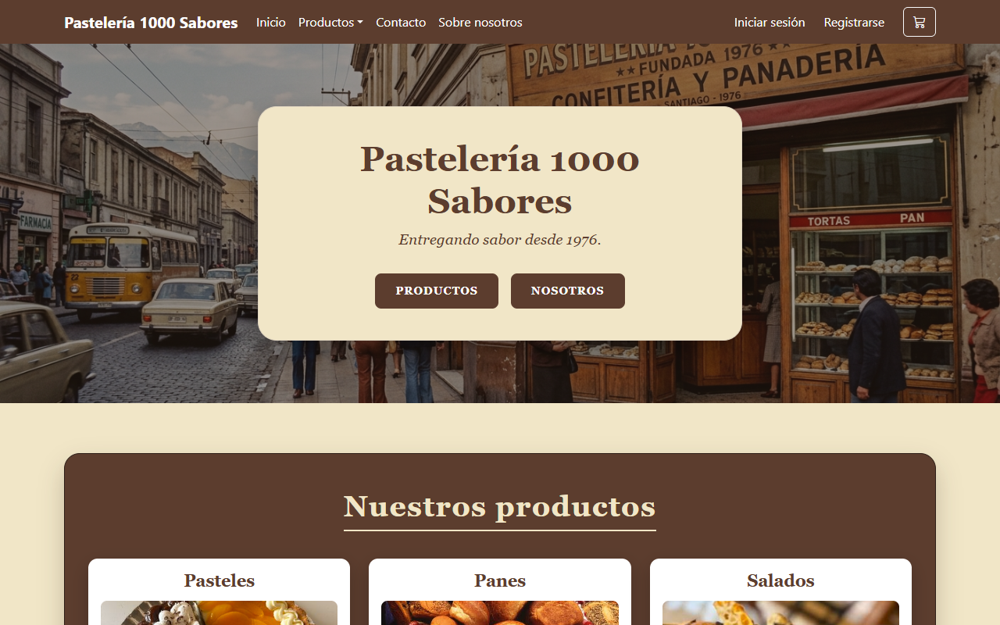

### 2.2 Categorías

En **Productos → Categorías** se ven las cuatro líneas de la pastelería con la cantidad de productos disponibles: **Pastelería**, **Panadería**, **Productos salados** y **Productos sin azúcar**. El botón **Ver …** abre el catálogo de cada una.

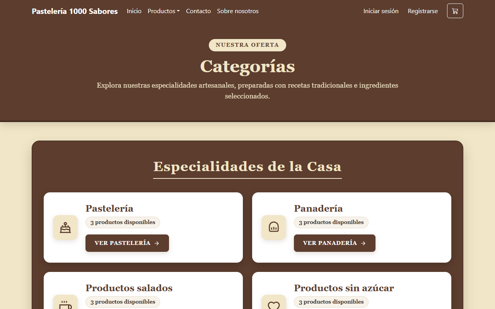

### 2.3 Catálogo, búsqueda y orden

Cada categoría muestra sus productos en tarjetas con imagen, descripción y precio.

- **Buscar productos**: escribe parte del nombre o la descripción (por ejemplo, "chocolate") y la lista se filtra al instante.
- **Ordenar por**: *Orden predeterminado*, *Menor precio* o *Mayor precio*.
- **Ver** abre el detalle del producto; **Agregar al carrito** suma una unidad.

Cuando un producto tiene descuento, la tarjeta muestra el precio original tachado y el precio final. Esos productos también aparecen en **Productos → Ofertas**.

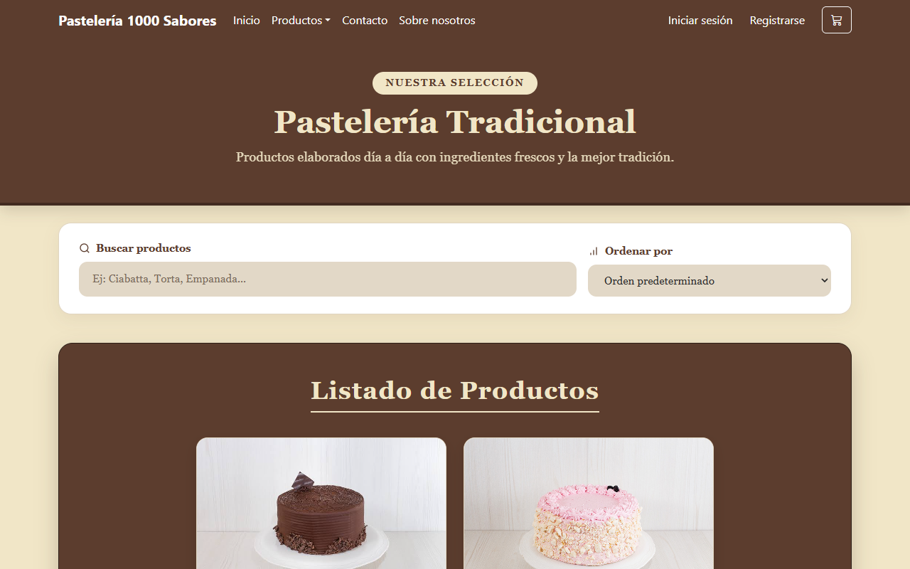

### 2.4 Detalle de un producto

Muestra la imagen grande, la categoría, la descripción completa y el precio.

1. Indica la **Cantidad** (de 1 en adelante).
2. Presiona **Agregar al carrito**.
3. Aparece el aviso **"¡Producto agregado a tu carrito!"** y el número del carrito aumenta.

**Volver al catálogo** regresa a la lista de la categoría.

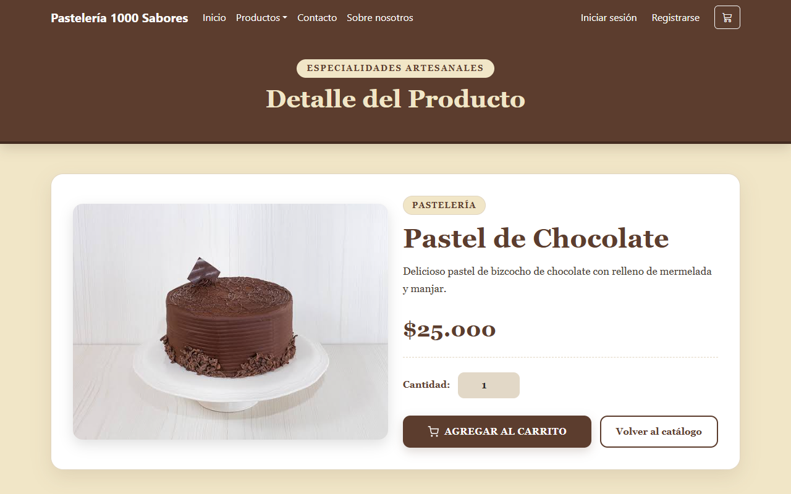

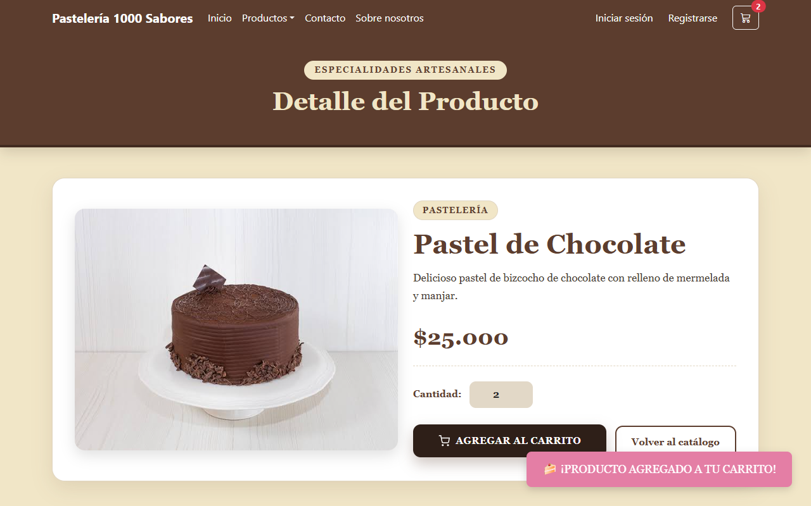

Al agregar desde la tarjeta del catálogo aparece el mismo aviso en la esquina inferior derecha:

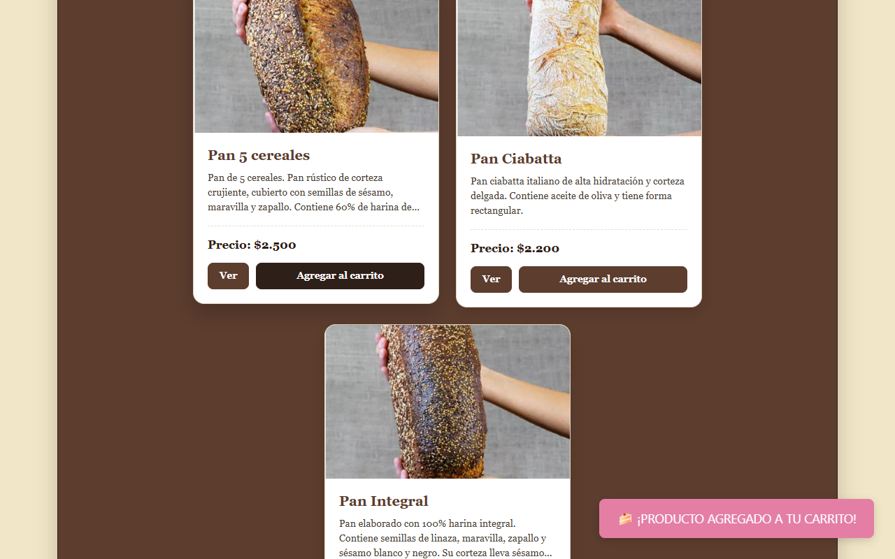

---

## 3. Carrito de compras

Se abre con el ícono del carrito en la barra superior.

- **−** y **+** cambian la cantidad de cada producto; el subtotal se actualiza al momento.
- **Eliminar** quita un producto; **Vaciar carrito** quita todos.
- El **Resumen de Compra** muestra la cantidad de productos y el **Total a pagar** (con descuentos aplicados).
- **Continuar con la compra** lleva al checkout.

El carrito se guarda en el navegador, así que se conserva aunque cierres la pestaña o recargues la página.

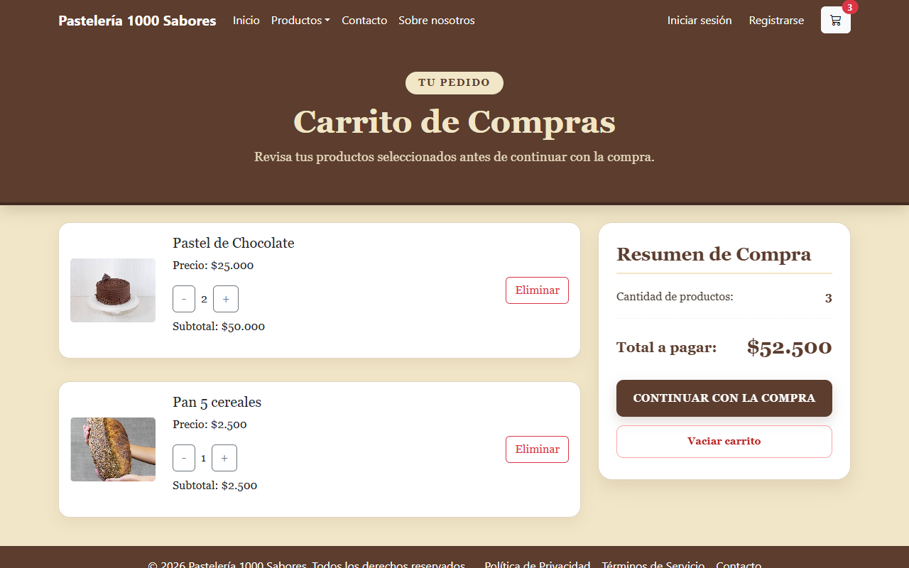

---

## 4. Crear una cuenta

En **Registrarse**:

1. Completa **Nombre** y **Apellido**.
2. Ingresa un **Correo electrónico** válido. Debe ser único: si ya existe una cuenta con ese correo, se mostrará un aviso.
3. Crea una **Contraseña** de al menos 8 caracteres.
4. Escribe la **Dirección de envío** y, si quieres, el **Tipo de propiedad** (casa, departamento, etc.).
5. Selecciona la **Región** y escribe la **Comuna**.
6. Presiona **Registrarse**.

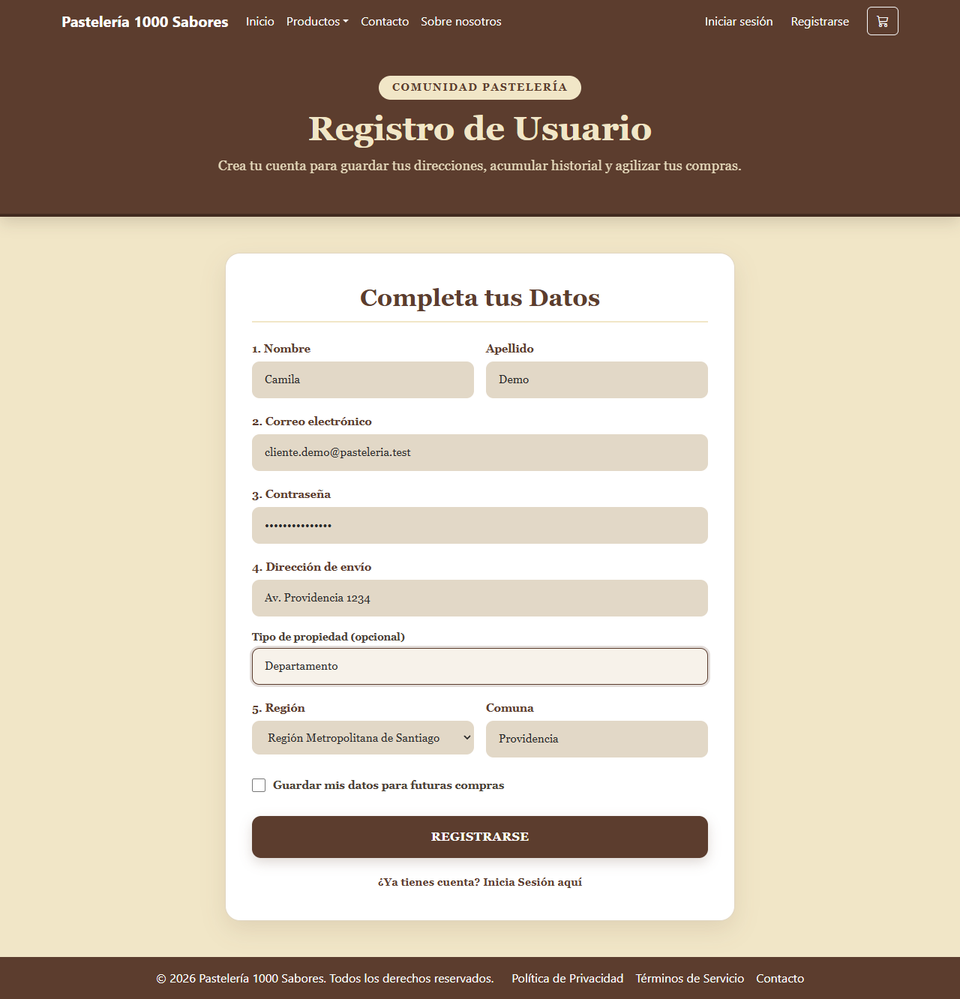

Si todo está correcto aparece **"Registro realizado correctamente. Serás redirigido al inicio de sesión."** y la página pasa sola a **Iniciar sesión**. Si falta un dato o tiene un formato inválido, el mensaje indica cuál corregir.

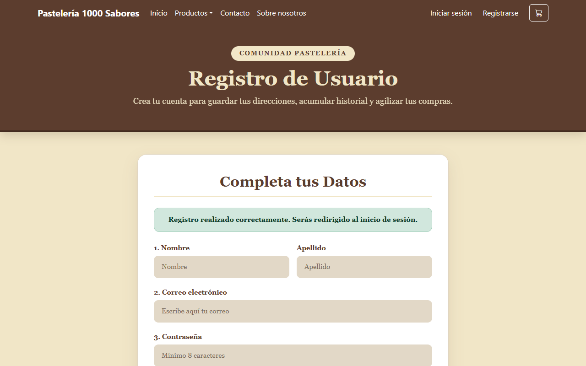

---

## 5. Iniciar sesión y perfil

### 5.1 Iniciar sesión

1. Ingresa tu **Correo electrónico** y **Contraseña**.
2. Marca **Recordar mi cuenta** si quieres seguir conectado aunque cierres el navegador. Sin marcarla, la sesión dura hasta cerrar la pestaña.
3. Presiona **Iniciar Sesión**.

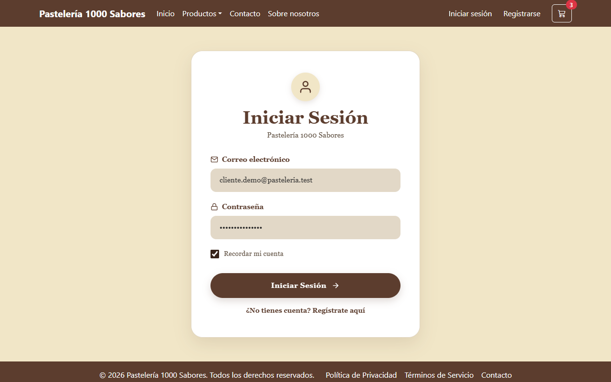

La sesión se mantiene al recargar la página y se renueva sola mientras usas la tienda. Por seguridad, después de varios días o si la sesión deja de ser válida, el sistema la cierra y vuelve a pedir el inicio de sesión.

### 5.2 Mi perfil

Después de iniciar sesión se abre **Mi Perfil** con tus datos (correo, dirección y fecha del último pedido) y el **Historial de Pedidos**. Si todavía no compras nada, aparece el botón **Explorar Productos**.

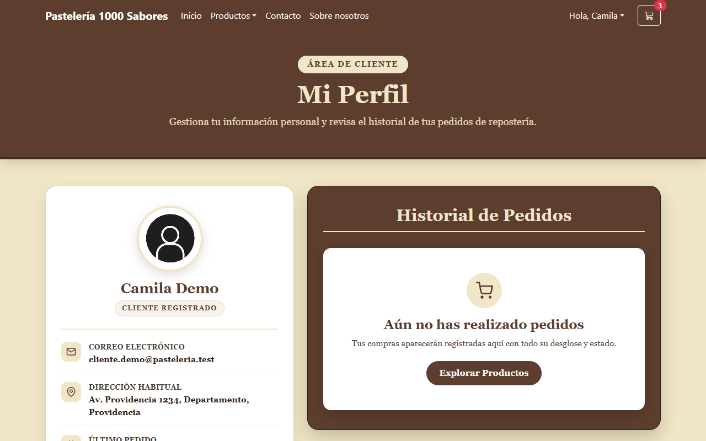

### 5.3 Menú de la cuenta

En la barra superior aparece **Hola, [tu nombre]**. Al hacer clic se abre el menú con **Mi perfil** y **Cerrar sesión**. Un cliente no ve la opción de administración.

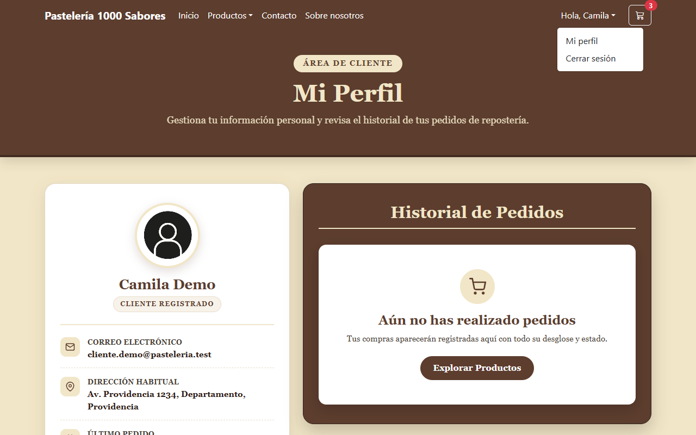

Para salir, usa **Cerrar sesión** en este menú o el botón del mismo nombre en el perfil.

---

## 6. Comprar

### 6.1 Checkout

Desde el carrito, **Continuar con la compra** abre **Finalizar Compra**:

1. Revisa o completa los **Datos de Envío & Cliente**: nombre, correo, dirección, comuna y región. Si iniciaste sesión, vienen completados con los datos de tu cuenta.
2. Elige la **Opción de entrega**: **Despacho a domicilio** ($3.000) o **Retiro en tienda** ($0).
3. En **Resultado del pago simulado** elige *Pago aprobado* o *Pago rechazado*. La tienda es una demostración y no realiza cargos reales.
4. Revisa el **Resumen de Compra** a la derecha (productos, entrega y total).
5. Presiona **Confirmar compra**.

También se puede comprar sin cuenta: el pedido queda asociado al correo ingresado.

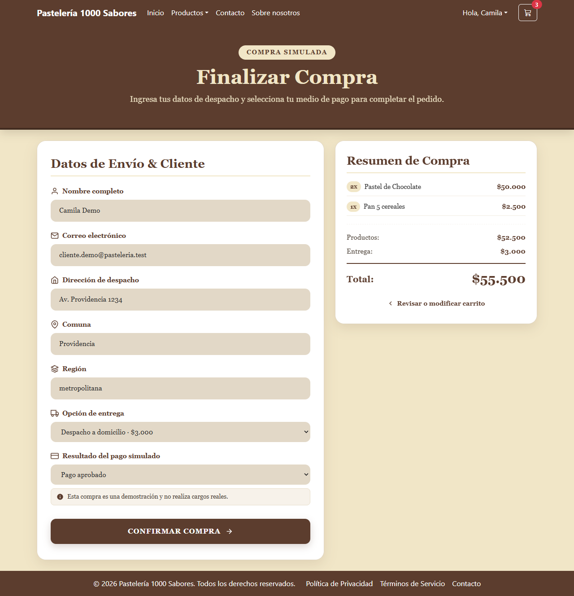

### 6.2 Compra confirmada

Con el pago aprobado se registra el pedido y se vacía el carrito. La pantalla muestra el número de pedido, la fecha, el estado, los productos con el precio pagado, el costo de entrega, el total y los datos de entrega. Desde aquí puedes **Seguir comprando** o **Ver historial**.

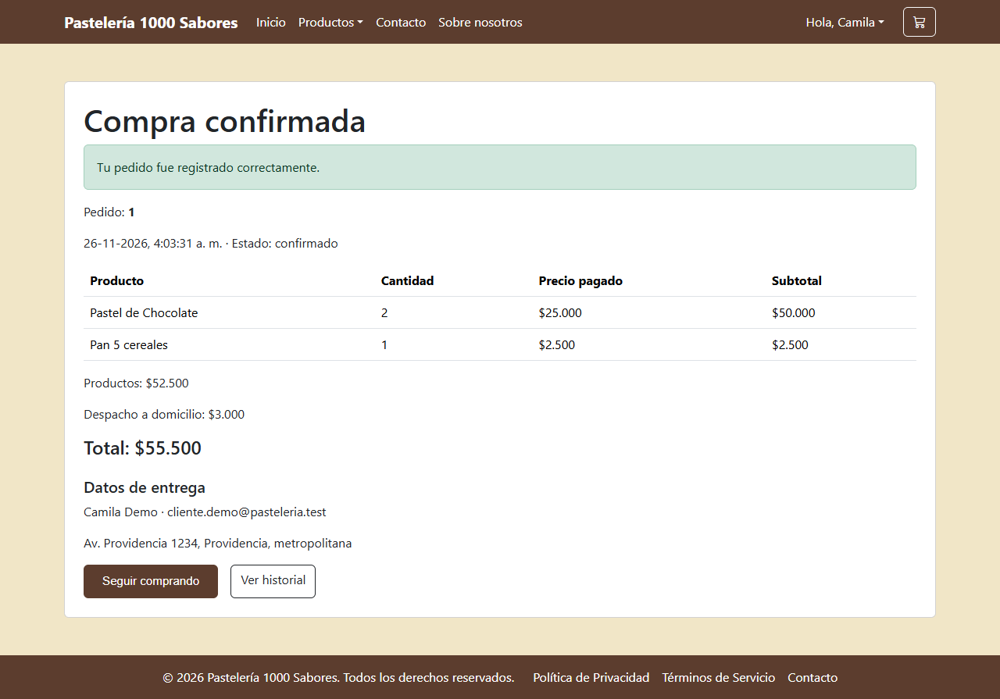

El pedido aparece en el **Historial de Pedidos** del perfil. **Ver detalle completo** abre de nuevo la confirmación.

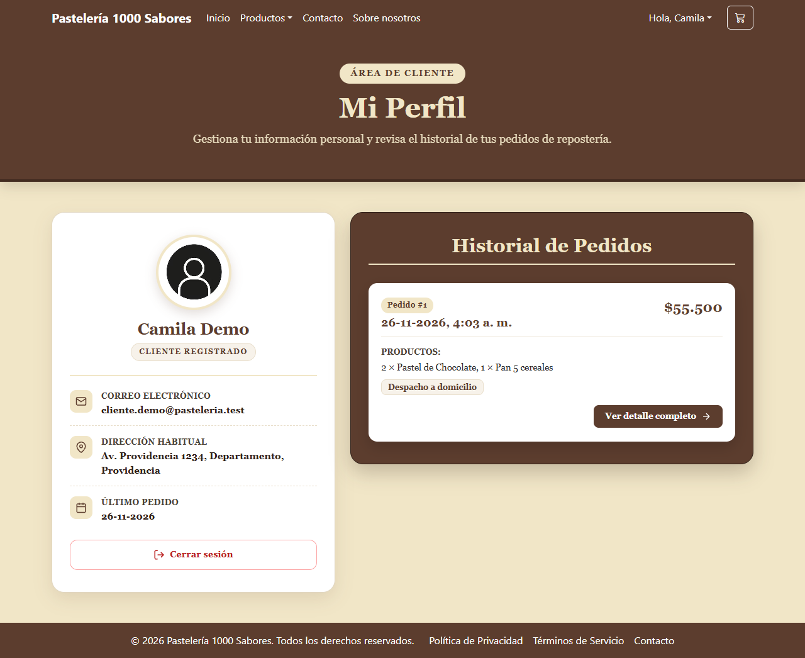

### 6.3 Pago rechazado

Si el pago es rechazado **no se registra ningún pedido** y el carrito se conserva. **Volver a intentar** regresa al checkout y **Revisar carrito** permite cambiar los productos.

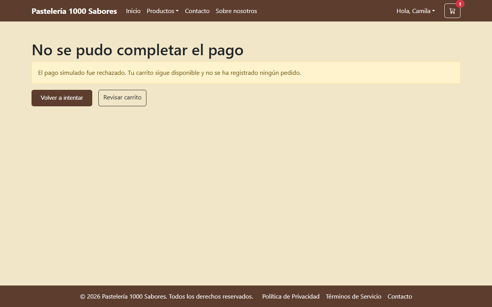

---

## 7. Contacto

En **Contacto**:

1. Escribe tu **Dirección Mail** (obligatoria) y, si quieres, tu **Nombre**.
2. Escribe tu consulta en **Ingrese su consulta**.
3. Presiona **Enviar consulta**.

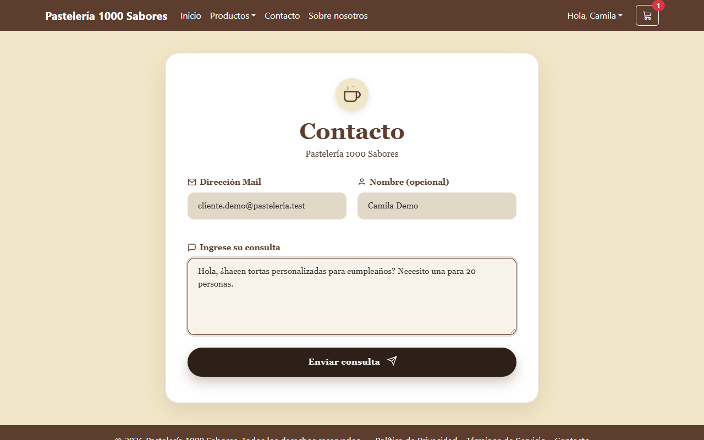

Al enviarla aparece **"Tu consulta fue enviada correctamente."** y el formulario se limpia. El administrador la verá en su panel.

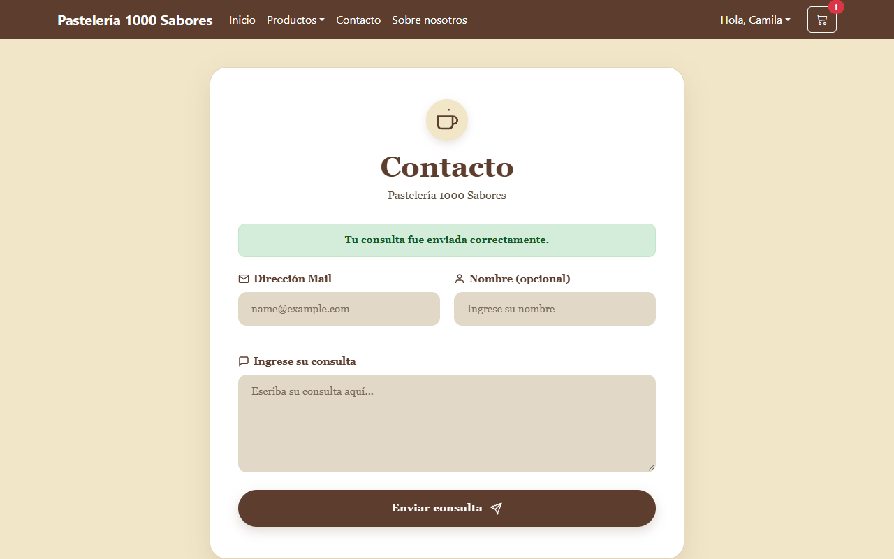

---

## 8. Panel de administración

Solo para la cuenta de **administrador**.

### 8.1 Entrar al panel

Inicia sesión con la cuenta de administrador. En el menú **Hola, Administrador** aparece la opción **Panel de administración**.

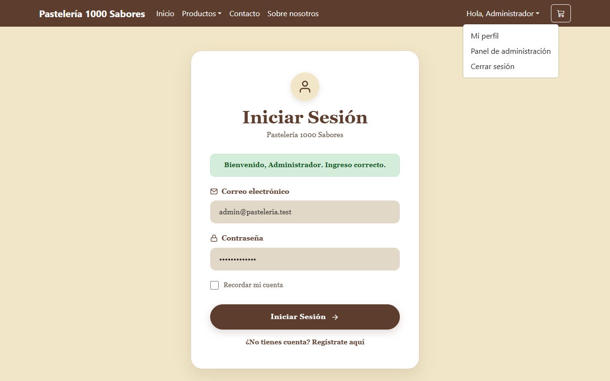

Si un visitante o un cliente intenta abrir `/administrador` escribiendo la dirección, la tienda lo redirige (al inicio de sesión o a la página de inicio). Además, el servidor rechaza cualquier acción de administración que no venga de un administrador.

### 8.2 Dashboard de ventas

El panel abre con cuatro accesos (**Ver Ventas**, **Ver Consultas**, **Ver Productos**, **Ver Usuarios**) y el **Dashboard de Ventas**:

- **Ingresos totales**, **Total pedidos**, **Ticket promedio** y **Unidades vendidas**.
- **Más vendidos**: ranking de productos por unidades.
- **Últimas ventas registradas**: número de pedido, fecha, cliente y total.

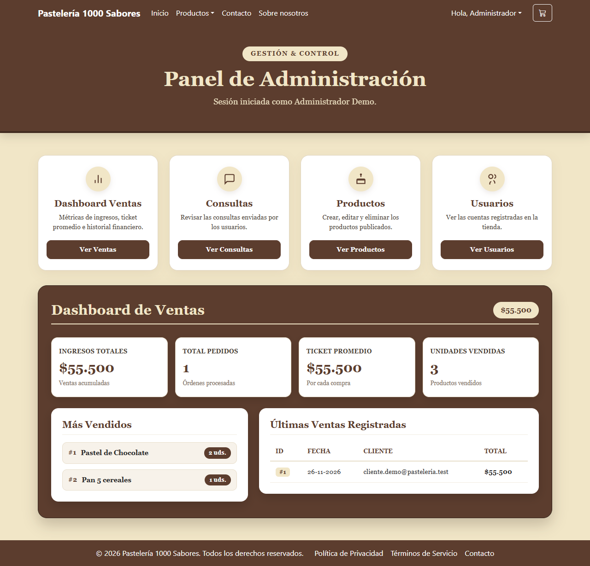

### 8.3 Productos

Con **Ver Productos** se abre **Catálogos Publicados**:

**Crear un producto**
1. Completa **Nombre del producto**, **Descripción**, **Ruta o URL de la imagen**, **Precio en pesos** (entero mayor que cero), **Descuento (%)** (de 0 a 100) y **Categoría**.
2. Presiona **Guardar producto**. Aparece en la tabla y en el catálogo de la tienda.

**Editar un producto**
1. En la tabla **Productos registrados**, presiona **Editar** en la fila del producto.
2. El formulario cambia a **Editar producto** con los datos cargados. Modifica lo necesario.
3. Presiona **Guardar cambios**, o **Cancelar edición** para descartar.

Si cambias el precio o el descuento, el carrito de los clientes se actualiza con el nuevo valor. Los pedidos ya realizados conservan el precio que se pagó.

**Eliminar un producto**
1. Presiona **Eliminar** en la fila del producto.
2. Aparece **"¿Eliminar [producto]?"**: presiona **Confirmar eliminación**, o **Cancelar** para dejarlo.

La tabla muestra para cada producto la categoría, el precio, el descuento y el **precio final**. Los botones inferiores abren el catálogo público de cada categoría.

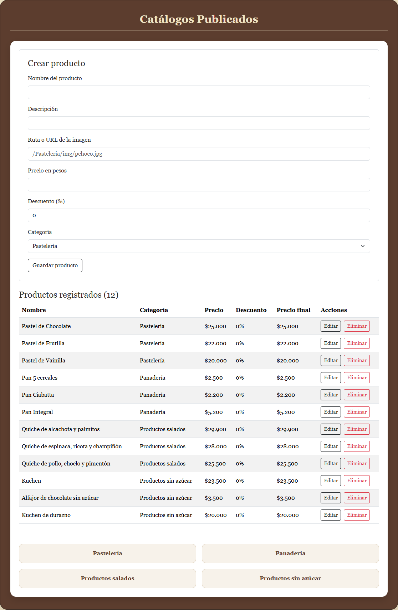

### 8.4 Consultas

Con **Ver Consultas** se listan los mensajes recibidos desde Contacto, con fecha, correo y texto. En la columna **Estado** se elige **Pendiente**, **En revisión** o **Resuelta**; el cambio se guarda al seleccionarlo.

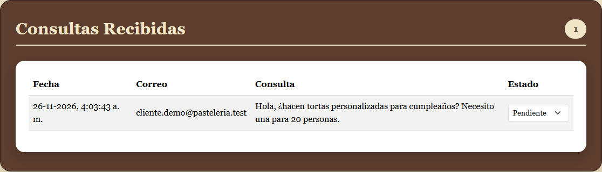

### 8.5 Usuarios

Con **Ver Usuarios** se ven las cuentas registradas con su nombre, correo, región, comuna, tipo de propiedad y **rol** (Administrador o Cliente).

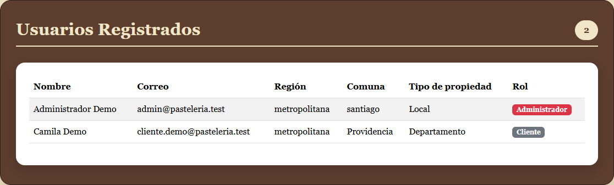

---

## 9. Uso en el celular

La tienda se adapta a pantallas pequeñas. En el celular, la barra superior se reduce a un botón de menú (☰) que despliega las mismas opciones: páginas, sesión y carrito.

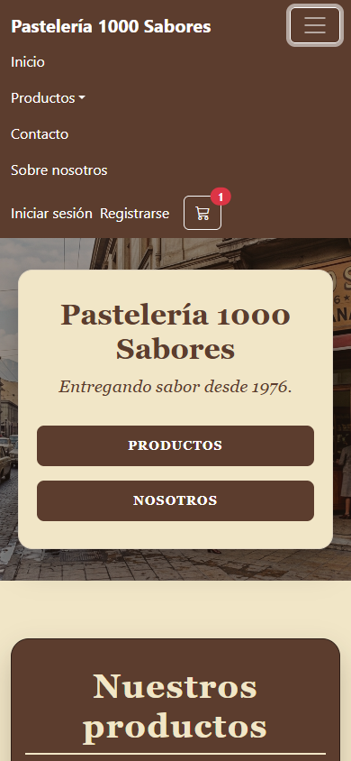

---

## 10. Mensajes frecuentes y solución de problemas

| Mensaje o situación | Qué significa | Qué hacer |
| --- | --- | --- |
| "Ya existe una cuenta asociada a ese correo." | El correo ya está registrado | Inicia sesión con ese correo o usa otro |
| "El correo o la contraseña son incorrectos." | Datos de acceso inválidos | Revisa mayúsculas y vuelve a escribir la contraseña |
| "Tu sesión expiró o no es válida. Inicia sesión nuevamente." | La sesión venció o dejó de ser válida | Vuelve a iniciar sesión; el carrito no se pierde |
| "No tienes permiso para realizar esta acción." | La acción es solo para administradores | Inicia sesión con la cuenta de administrador |
| "Hay productos no disponibles. Revisa tu carrito." | Un producto del carrito fue eliminado del catálogo | Abre el carrito, quita ese producto y vuelve a comprar |
| "No se pudo conectar con el servidor." | El backend no está en ejecución o no hay conexión | Inicia el backend y recarga la página |
| La tienda aparece sin productos | El backend no responde o la base no tiene productos | Revisa que el backend esté en ejecución; al arrancar con la base vacía carga el catálogo inicial |
| Al abrir Perfil vuelve a Iniciar sesión | No hay una sesión activa | Inicia sesión |
| Al abrir el panel vuelve al inicio | La cuenta no es de administrador | Usa la cuenta de administrador |

---

*Las capturas se generan con `node scripts/capturas-manual.mjs` desde `FrontPasteleria`, con el front y el backend en ejecución. El script usa la cuenta de demostración `cliente.demo@pasteleria.test` y deja en la base una compra y una consulta de ejemplo.*
